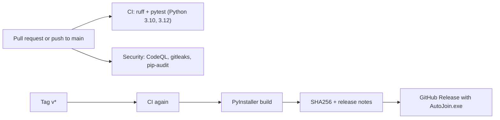
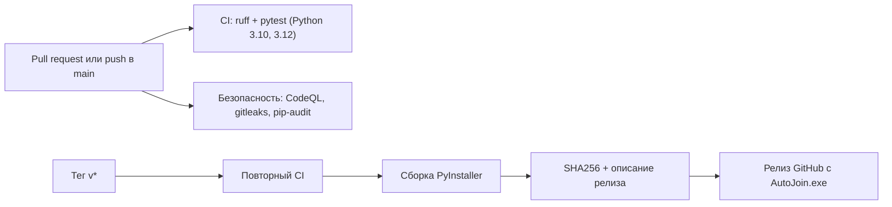

[](https://github.com/tukovsky/AutoJoin/actions/workflows/ci.yml)

# AutoJoin

The Russian version of this README is below: [Русская версия ↓](#русская-версия)

A Windows program that joins Webex and Teams meetings by itself on a weekly schedule and leaves them at the set time.

## Features

- Weekly schedule: for each meeting you pick the days of the week, the join time and the leave time. The meeting repeats every week.
- Webex: opens the link in Chrome, enters your name, dismisses the microphone and camera prompts with "Continue without using microphone and camera" and joins.
- Teams: opens the Teams desktop app from the link and presses "Join now". The microphone and camera are never turned on by the program.
- Leaves the meeting at the scheduled time.
- Import from an iCal (`.ics`) file: a university timetable exported from MAIS (button "Export do iCal") or any calendar with weekly events turns into a list of meetings. You only add the links.
- Each meeting can be switched on or off with the green check / red cross in the first column of the schedule (click it).
- Interface in Russian and English: the RU / EN switch is in the top right corner. The choice is remembered.
- Protection against failures: up to 5 join attempts with growing pauses, waiting for the internet and continuing when it returns, automatic rejoin if the connection to the meeting is lost, leaving the previous meeting when the next one starts, the computer does not fall asleep while the queue runs, only one copy of the program can run, a damaged `meetings.json` is saved as `meetings.broken.json` instead of being lost.
- If you leave a meeting by hand, the program will join it again. To keep it away, click the red cross for that meeting or press "Stop".

## Requirements

- Windows 10 or 11
- Google Chrome
- Microsoft Teams desktop app (only for Teams meetings)
- Python 3.10+ (only if you run from source)

## Run from source

```
pip install -r requirements.txt
python -m playwright install chromium
python app.py
```

## Build the exe

Locally: run `build.bat`. The result is `dist\AutoJoin.exe`.

On GitHub: create a tag like `v1.0.0` (for example via Releases → Draft a new release). The `Release` workflow builds `AutoJoin.exe` and attaches it to the release.

## How to use

1. Enter your name.
2. Add meetings: platform, link, days of the week, join time and leave time.
3. Press "Запустить очередь" (Start queue) and keep the program open.

The meeting list and your name are stored in `meetings.json` next to the program. The file is excluded from the repository because it contains meeting links.

## First Teams run

Teams is opened through Chrome. Once, Chrome may ask "Open Microsoft Teams?". Tick "Always allow" and press "Open Microsoft Teams". The choice is saved in the `chrome_profile` folder next to the program.

## Troubleshooting

A screenshot `debug_*.png` is saved next to the program, and the log at the bottom of the window shows the step where the program stopped.

## Tests and CI

```
pip install pytest
python -m pytest
```

The tests cover the schedule logic and the Webex join flow on mock pages from `tests/mock`. The same tests and a code check run on GitHub Actions on every push (workflow `CI`). Joining the Teams desktop app is not tested automatically: it needs Windows with Teams installed.

## Project structure

| Path | Purpose |
| --- | --- |
| `app.py` | the whole program |
| `requirements.txt` | Python dependencies |
| `build.bat` | local exe build |
| `tests/` | tests and mock pages |
| `.github/workflows/` | CI, release and security workflows |
| `.github/dependabot.yml` | automatic dependency updates |
| `CHANGELOG.md` | list of changes per version |

## CI/CD pipeline



- `ci.yml` is reusable: the same tests run for every pull request and again before every release.
- `release.yml` builds the exe only after the tests pass, writes the tag into the program as its version and attaches `AutoJoin.exe` and `AutoJoin.exe.sha256`.
- `security.yml` runs CodeQL, secret scanning and a dependency audit. `dependabot.yml` opens pull requests for outdated dependencies and actions.

Check a download (PowerShell): `(Get-FileHash AutoJoin.exe -Algorithm SHA256).Hash` and compare it with the `.sha256` file from the release.

## Development

```
git switch -c feature/my-change
python -m pip install -r requirements.txt pytest pytest-cov ruff
python -m pytest
ruff check --select E4,E7,E9,F .
```

Open a pull request into `main`; merge when CI is green. To release: add a line to `CHANGELOG.md`, then create a tag such as `v0.3.0`.

---------------------------------

# Русская версия

Программа для Windows, которая сама заходит на собрания Webex и Teams по дням недели и выходит из них в заданное время.

## Возможности

- Расписание по дням недели: для каждого собрания выбираются дни, время входа и время выхода. Собрание повторяется каждую неделю.
- Webex: открывает ссылку в Chrome, вводит имя, закрывает окна про микрофон и камеру кнопкой «Продолжить без использования микрофона и камеры» и заходит.
- Teams: открывает приложение Teams по ссылке и нажимает «Присоединиться сейчас». Микрофон и камеру программа не включает.
- Выход из собрания в назначенное время.
- Импорт из файла iCal (`.ics`): расписание, выгруженное из МАИС (кнопка «Export do iCal»), или любой календарь с еженедельными событиями превращается в список собраний. Остаётся только вставить ссылки.
- Каждое собрание можно включить или выключить зелёной галочкой / красным крестиком в первом столбце расписания (нажмите на него).
- Интерфейс на русском и английском: переключатель RU / EN в правом верхнем углу. Выбор запоминается.
- Защита от сбоев: до 5 попыток входа с растущими паузами, ожидание интернета и продолжение, когда он вернётся, автоматический повторный вход при потере связи с собранием, выход из предыдущего собрания, когда начинается следующее, компьютер не засыпает, пока работает очередь, нельзя запустить две копии программы, повреждённый `meetings.json` сохраняется как `meetings.broken.json`, а не теряется.
- Если выйти из собрания вручную, программа зайдёт в него снова. Чтобы этого не было, нажмите красный крестик у этого собрания или «Остановить».

## Требования

- Windows 10 или 11
- Google Chrome
- Приложение Microsoft Teams (только для собраний в Teams)
- Python 3.10+ (только если запускаете из исходников)

## Запуск из исходников

```
pip install -r requirements.txt
python -m playwright install chromium
python app.py
```

## Сборка exe

Локально: запустить `build.bat`, готовый файл появится в `dist\AutoJoin.exe`.

Через GitHub: создать тег вида `v1.0.0` (например, через Releases → Draft a new release). Workflow `Release` соберёт `AutoJoin.exe` и прикрепит его к релизу.

## Как пользоваться

1. Вписать своё имя.
2. Добавить собрания: платформа, ссылка, дни недели, время входа и выхода.
3. Нажать «Запустить очередь» и оставить программу открытой.

Список собраний и имя хранятся в `meetings.json` рядом с программой. Файл исключён из репозитория, потому что в нём лежат ссылки на собрания.

## Первый запуск Teams

Teams открывается через Chrome. Один раз Chrome может спросить «Открыть приложение Microsoft Teams?». Нужно отметить «Всегда разрешать» и нажать «Открыть приложение». Выбор сохраняется в папке `chrome_profile` рядом с программой.

## Если что-то не сработало

Рядом с программой сохраняется скриншот `debug_*.png`, а в журнале внизу окна пишется, на каком шаге остановилась программа.

## Тесты и CI

```
pip install pytest
python -m pytest
```

Тесты проверяют логику расписания и вход в Webex на тестовых страницах из `tests/mock`. Те же тесты и проверка кода запускаются на GitHub Actions при каждом push (workflow `CI`). Вход в приложение Teams автоматически не проверяется: для этого нужен Windows с установленным Teams.

## Структура проекта

| Путь | Назначение |
| --- | --- |
| `app.py` | вся программа |
| `requirements.txt` | зависимости Python |
| `build.bat` | локальная сборка exe |
| `tests/` | тесты и тестовые страницы |
| `.github/workflows/` | CI, выпуск релиза и проверки безопасности |
| `.github/dependabot.yml` | автоматическое обновление зависимостей |
| `CHANGELOG.md` | список изменений по версиям |

## Конвейер CI/CD



- `ci.yml` вызывается повторно: одни и те же тесты идут для каждого pull request и ещё раз перед каждым релизом.
- `release.yml` собирает exe только после зелёных тестов, записывает версию из тега в программу и прикрепляет `AutoJoin.exe` и `AutoJoin.exe.sha256`.
- `security.yml` запускает CodeQL, поиск секретов и проверку зависимостей. `dependabot.yml` сам предлагает обновления зависимостей и actions.

Проверить скачанный файл (PowerShell): `(Get-FileHash AutoJoin.exe -Algorithm SHA256).Hash`, затем сравнить с файлом `.sha256` из релиза.

## Разработка

```
git switch -c feature/my-change
python -m pip install -r requirements.txt pytest pytest-cov ruff
python -m pytest
ruff check --select E4,E7,E9,F .
```

Откройте pull request в `main` и сливайте, когда CI зелёный. Для релиза: добавьте строку в `CHANGELOG.md` и создайте тег вида `v0.3.0`.
